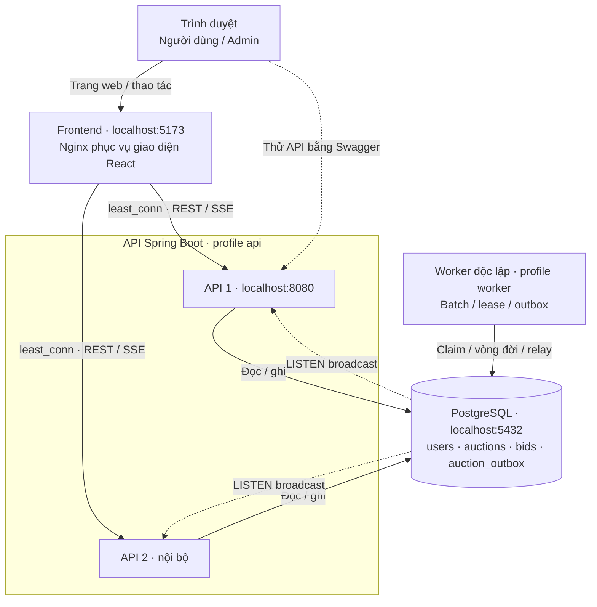

# Kiến trúc tổng quan KTPM

Sơ đồ thể hiện năm container Docker và các cổng mặc định. React chạy trong trình duyệt; Nginx phục vụ HTML/CSS/JS và cân bằng request `/api` tới hai API. Swagger truy cập trực tiếp API đầu ở cổng 8080. Worker có pool riêng, xử lý lịch/outbox và có thể mở rộng độc lập.

- **Phân tầng:** API → Nghiệp vụ → Truy cập dữ liệu. Application dùng model/luật và interface trong Domain; nghiệp vụ không import web/JPA. Infrastructure triển khai các interface và transaction. `UnitOfWork` thuộc common.
- **Bảo mật:** Spring Security/JWT filter xác thực trước controller; endpoint công khai không cần token, endpoint admin cần quyền ADMIN. Code security thuộc `auth/infrastructure`.
- **Scheduler:** thuộc `auction/infrastructure`, claim batch bằng SKIP LOCKED, xử lý song song có giới hạn và retry/backoff; token/lease bảo vệ nhiều worker.
- **Realtime:** trigger ghi outbox cùng transaction, relay phát PostgreSQL NOTIFY, mọi API LISTEN và phát SSE; reconnect đồng bộ lại REST.
- **Dữ liệu:** PostgreSQL lưu bền trong Docker volume; Flyway quản lý migration qua bảng kỹ thuật `flyway_schema_history`.

Khi chạy trực tiếp, Vite thay Nginx và PostgreSQL portable dùng cổng 55432; mặc định một backend tổng hợp chạy cả worker/SSE. Giao diện tự cập nhật, có refresh dự phòng khi mất realtime. Xem [Pha 2](PHA_2.md) cho cấu hình, giới hạn, metrics và cách đo lại.
