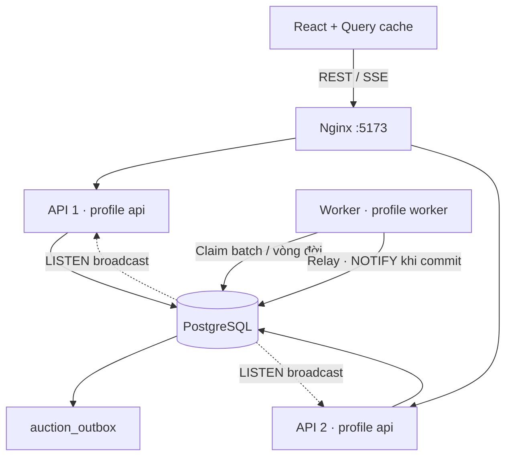

# Pha 2 — Đồng thời, worker và cập nhật thời gian thực

Pha 2 giữ REST API và luật đấu giá của Pha 1, bổ sung SSE công khai và thay đổi cách ghi bid, xử lý lịch, triển khai và theo dõi tải. [Kết quả kiểm chứng](../reports/phase-two/VALIDATION.md): 42 test backend, 32 frontend, 9 E2E và 20 test công cụ benchmark qua. [Báo cáo Pha 1](../reports/kaggle-p1-60e076a7/BAO_CAO_PHA1.md) vẫn là số liệu của phiên bản cũ; chưa được dùng để khẳng định phần trăm cải thiện Pha 2.

## 1. Các hướng đã triển khai

| Hướng | Thay đổi trong source | Kiểm chứng |
|---|---|---|
| Rút ngắn transaction bid | Đọc snapshot rồi UPDATE có điều kiện theo giá/bid dẫn đầu; chỉ giữ khóa từ lúc đặt chỗ giá. Đổi trạng thái bid cũ bằng UPDATE, không tải entity cũ | Race 12 người, giá bằng nhau, snapshot cũ, rollback, bid phải chờ khóa qua giờ đóng |
| Batch và worker song song | Claim một batch giới hạn bằng `FOR UPDATE SKIP LOCKED`; pool hữu hạn, transaction riêng cho từng phiên; đóng toàn bộ bid bằng một bulk UPDATE | Hai worker không nhận trùng, bỏ qua hàng đang khóa, token cũ không xử lý lease mới |
| Worker độc lập | Profile `api` tắt scheduler/outbox relay; profile `worker` bật scheduler/relay, tắt SSE; chung JAR và PostgreSQL | Docker có service worker riêng; có thể chạy thêm worker với cùng DB |
| Nhiều API sau Nginx | Hai service API, upstream `least_conn`; JWT/thu hồi token kiểm tra DB; mỗi API có LISTEN riêng | Hai kết nối LISTEN đều nhận sự kiện từ cùng relay |
| Realtime và phục hồi | Outbox ghi cùng transaction bằng trigger; relay phát PostgreSQL NOTIFY; SSE invalidation, reconnect đọc lại REST, fallback khi mất kết nối | Rollback không sinh sự kiện; relay lỗi không đánh dấu đã gửi; frontend kiểm tra gom sự kiện và reconnect |
| Query/index/cache | Index từng hàng đợi thời gian, trạng thái + ID, xếp hạng bid, trạng thái bid, GIN trigram tìm tên; giữ phân trang tối đa 100 | Migration chạy với PostgreSQL thật; cache frontend 2 giây, invalidation theo phiên |
| Kiểm soát tải | API semaphore, pool DB/HTTP hữu hạn, timeout transaction/SQL/khóa; Nginx rate limit bid và đăng nhập, giới hạn SSE | Test bão hòa trả 503 ngay và trả lại slot sau request |
| Quan sát | Actuator metrics/Prometheus, retry bid, thời gian giữ/chờ reservation, worker, lag, outbox backlog, SSE và PostgreSQL lock waiters | Test nghiệp vụ và endpoint bảo vệ quyền; số liệu tải cần chạy benchmark riêng |

## 2. Kiến trúc chạy Docker



Chạy tại gốc: `docker compose up --build -d`. Có năm container: PostgreSQL, hai API, worker, frontend/Nginx. `localhost:5173` dùng cân bằng tải; `localhost:8080` đi thẳng API đầu để Swagger/chẩn đoán. Replica và worker không mở cổng ra host. Chỉ API đầu seed tài khoản demo. Dữ liệu cũ được nâng cấp bằng Flyway V2, không cần xóa volume.

API/worker đều có `/actuator/health` nội bộ để Compose kiểm tra sẵn sàng. Worker có HTTP phục vụ health/metrics nhưng không được Nginx đưa vào upstream xử lý request của người dùng. Có thể mở rộng worker bằng `docker compose up -d --scale worker=2`; hai worker vẫn dùng claim và fencing token trong cùng DB.

Launcher portable giữ một tiến trình tổng hợp để phát triển (`dev`), vẫn dùng batch worker và SSE. Để tách tiến trình với PostgreSQL riêng, build `backend/target/ktpm-backend-1.0.0.jar` rồi chạy:

```powershell
$env:DATABASE_URL='jdbc:postgresql://localhost:5432/ktpm'
$env:DATABASE_USERNAME='ktpm'
$env:DATABASE_PASSWORD='ktpm_dev'
# Đặt JWT_SECRET dùng chung cho tất cả API/worker qua biến môi trường.
java -jar backend/target/ktpm-backend-1.0.0.jar --spring.profiles.active=api --server.port=8080
# Terminal khác, cùng cấu hình DB/JWT:
java -jar backend/target/ktpm-backend-1.0.0.jar --spring.profiles.active=worker --server.port=8082
```

## 3. Tính đúng của bid và lịch

`reserveBid` chỉ thành công khi giá và winningBidId còn giống snapshot. Nếu có ghi đồng thời, transaction hiện tại rollback và thử lại từ dữ liệu mới, tối đa 16 lần; mọi lần đều kiểm tra luật và deadline. Không tự retry một bid đã commit và không tự tăng amount thay người dùng. Hết ngân sách tranh chấp trả 409 để client quyết định gửi lại.

UPDATE có kiểm tra thời gian DB; `RETURNING` kiểm tra deadline sau khi lấy khóa để chặn cả trường hợp request chờ một transaction chỉ khóa hàng mà không đổi giá. Bid mới, trạng thái bid trước, giá/người dẫn đầu và outbox cùng commit hoặc cùng rollback. Index unique WINNING tiếp tục bảo vệ một người dẫn đầu. Người đang dẫn đầu không được tự bid tiếp; API và giao diện cùng áp dụng luật này.

Scheduler nhận tối đa phần sức chứa còn trống, mặc định 64 job đang chạy/chờ và 4 thread. Claim có UUID token, lease 60 giây và số lần thử. Worker kiểm tra token/lease sau khi khóa hàng trong transaction xử lý. Worker chết để lại lease; lần quét sau khi lease hết có thể nhận lại. Worker cũ không được hoàn tất hay trả lại claim mới. Lỗi được giải phóng claim và chờ theo backoff 2–60 giây. Nếu ghi thông tin retry thất bại, lease vẫn bảo đảm có thể phục hồi.

Mở/đóng lặp lại giữ nguyên kết quả. Mỗi phiên commit riêng; lỗi một phiên không rollback cả batch. Claim dùng SKIP LOCKED nên một phiên đang bận không chặn các phiên khác.

## 4. Outbox, SSE và cache

Trigger ghi ID phiên vào `auction_outbox` khi tạo/xóa hoặc đổi trạng thái/bid thắng/giá cuối. Thay đổi lease và UPDATE đặt chỗ giá trung gian không phát thông báo riêng. Không có FK từ outbox về auctions, vì thông báo xóa cần tồn tại sau khi phiên bị xóa.

Relay claim tối đa 100 sự kiện bằng SKIP LOCKED, gom các ID trùng trong batch, gọi `pg_notify` và đánh dấu `published_at` trong cùng transaction. PostgreSQL chỉ phát NOTIFY sau commit. Rollback giữ sự kiện chưa gửi để lượt sau thử lại. Sự kiện đã gửi được dọn sau 24 giờ, mỗi lần tối đa 10.000 hàng.

Mỗi API dành một connection pool slot cho LISTEN. API chuyển sự kiện tới `/api/events`, chỉ chứa ID phiên công khai. SSE dùng pool gửi/queue và số client hữu hạn; client quá chậm có thể bị ngắt rồi reconnect. Heartbeat 15 giây, stream hết hạn sau 120 giây để reconnect định kỳ. Nginx tắt buffering cho SSE.

Thông báo dùng để invalidation; giá/người thắng luôn được đọc từ REST. Khi reconnect qua bất kỳ API nào, frontend đọc lại snapshot; khi LISTEN/stream lỗi, frontend làm mới mỗi 10 giây và khi focus/online. Đây là cơ chế đồng bộ trạng thái hiện tại, không phải replay đầy đủ lịch sử sự kiện theo Last-Event-ID. Outbox retry bảo vệ relay; snapshot/fallback khôi phục các thông báo mà một client đã bỏ lỡ.

Frontend gom burst trong 150 ms, invalidate chi tiết/lịch sử phiên liên quan và các danh sách; không làm mới danh tính theo từng bid. Cache Query có staleTime 2 giây, không cache giá trên đường xác thực bid. Tiền tiếp tục dùng BigDecimal/decimal.js và JSON không mất độ chính xác.

## 5. Giới hạn và cấu hình

| Biến / cấu hình | Mặc định | Ý nghĩa |
|---|---|---|
| `DB_POOL_SIZE` | 12/API | Bao gồm một connection LISTEN/API |
| `WORKER_DB_POOL_SIZE` | 8 | Pool riêng trong Compose |
| `API_MAX_CONCURRENT` | 48/API | Bão hòa trả 503 + Retry-After: 1 trước bước JWT/DB |
| `HTTP_THREADS` | 64 | Tomcat; queue accept 64, max connection 512 |
| `SCHEDULER_WORKERS` | 4 | Thread xử lý vòng đời mỗi worker |
| `SCHEDULER_BATCH_SIZE` | 64 | Tổng job đang chạy/chờ mỗi worker |
| `SCHEDULER_DELAY_MS` | 500 | Chu kỳ quét khi chạy tổng hợp; có thể ghi đè bằng property |
| `SSE_MAX_CLIENTS` | 200/API | Số kết nối realtime tối đa |
| Nginx bid | 10 request/giây/IP, burst 20 | Áp dụng route bid/lịch sử; 429 khi vượt giới hạn |
| Nginx login/register | 3 request/giây/IP, burst 10 | 429 khi vượt giới hạn |
| Nginx SSE | 5 kết nối/IP | Nhiều tab dùng chung giới hạn |
| Khóa / SQL / transaction | 2 / 5 / 8 giây | Tránh chờ tài nguyên vô hạn |

Giới hạn admission/connection là theo instance; rate limit theo IP tại Nginx hiện có. Khi mở rộng phải tính tổng pool của mọi API/worker so với `max_connections` PostgreSQL; hai API + một worker mặc định tối đa 32 connection. Đi trực tiếp cổng 8080 không qua rate limit của Nginx. Client không tự gửi lại POST bid sau lỗi mạng/503 vì kết quả commit có thể chưa biết; đọc lại lịch sử trước khi quyết định.

GIN trigram hỗ trợ tìm `%tên%`; query ngắn hoặc ít dữ liệu vẫn có thể được planner chọn scan. Các index bổ sung cũng tăng chi phí ghi; dùng EXPLAIN (ANALYZE, BUFFERS) và workload thật để đánh giá.

## 6. Metrics và đo lại

`/actuator/health` công khai. `/actuator/metrics`, `/actuator/prometheus` yêu cầu JWT ADMIN, lấy trực tiếp qua cổng backend để chẩn đoán. Prometheus có thể cấu hình bearer token phù hợp vòng đời xác thực hiện tại.

Các nhóm hữu ích: `http.server.requests`, `spring.data.repository.invocations`, `hikaricp.*`, `jvm.memory.*`, `jvm.gc.*`, `process.cpu.usage`, `system.cpu.usage`; `ktpm.bid.reserve`, `ktpm.bid.retries`, `ktpm.scheduler.*`, `ktpm.outbox.*`, `ktpm.db.lock.waiters`, `ktpm.api.rejected`, `ktpm.sse.*`. Histogram HTTP/reservation hỗ trợ tính percentile. Mẫu PostgreSQL/lag/backlog lấy mỗi 15 giây, phản ánh snapshot thay vì ghi lại mọi lần chờ khóa; thời gian reservation bao gồm thực thi SQL và chờ khóa. Dùng `pg_stat_activity`, `pg_locks` và EXPLAIN để tìm câu SQL cụ thể.

Kiểm tra source bằng `scripts/test.ps1 -PortablePostgres`, `npm.cmd test`, `npm.cmd run build` trong frontend. Playwright cần backend/worker đang chạy và Chromium (`npx.cmd playwright install chromium`); chạy `npm.cmd run test:e2e`. Có thể đặt `E2E_REPLICA_URL` để kiểm tra SSE qua API thứ hai.

Đo chính thức bằng [notebook P1/P2](KAGGLE_CPU.md), giữ runner/config P1, đo lại cả hai source trong cùng phiên CPU. Chế độ mặc định tổng hợp phù hợp so sánh cùng số tiến trình; lợi ích của topology nhiều API/worker cần lượt đo riêng cùng tổng CPU/RAM, ghi rõ cổng đi thẳng API hay qua Nginx. Không gán cải thiện hiệu năng chỉ từ kết quả unit/integration test.
